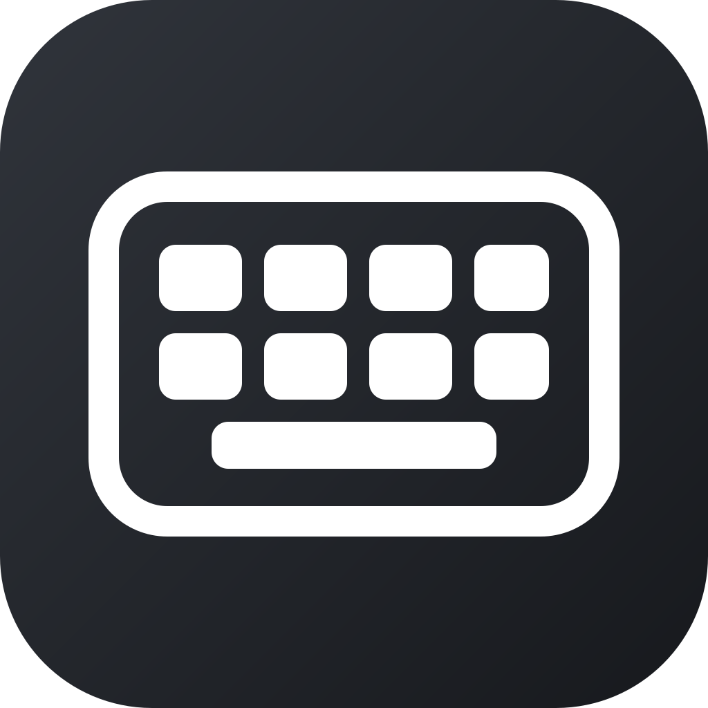

# Keyviz

Keyviz is a lightweight, native macOS menu bar app that displays your
keystrokes as clean key caps on screen. It is useful for demos, screen
recordings, presentations, and tutorials.



## Features

- Native AppKit app with no third-party dependencies
- Persistent keys that highlight while they are pressed
- WASD, arrow-key, and combined presets
- Custom selection of up to 12 keys
- Global key state across apps, Spaces, and full-screen windows
- Configurable opacity, color, and screen position
- Click-through overlay that never steals focus
- Remembers your preferences
- Runs only in the menu bar

## Install

1. Download and open `Keyviz-1.1.0-beta.dmg`.
2. Drag **Keyviz** to **Applications**.
3. Quit any older Keyviz version that is still running in the menu bar.
4. Open Keyviz and grant keyboard access when macOS asks.
5. Confirm the Keyviz menu shows **Global Key Listener Active**.
6. Use the keyboard icon in the menu bar to customize the overlay.

Because release builds are currently ad-hoc signed, macOS may require you to
right-click Keyviz and select **Open** the first time.

Choose **Displayed Keys → Customize Keys…** from the menu bar to select the
keys that remain visible. Changes are saved immediately, and closing the
chooser leaves Keyviz running in the menu bar. Selected boxes brighten while
their keys are held, including while you work in other apps.

macOS requires Input Monitoring permission to deliver keystrokes from other
apps. Keyviz shows **Global Key Listener Active** only after that permission is
granted and its native event tap is running. If an older Keyviz build is
already running during an upgrade, quit it from the keyboard menu before
opening the new version.

Keyviz observes keyboard events only to update the overlay. It does not
store or transmit keystrokes.

## Build

Requires macOS 13 or later and the Swift toolchain from Xcode or Xcode Command
Line Tools.

```sh
./Scripts/test.sh
./Scripts/package-dmg.sh
```

The app bundle and disk image are written to `build/`.

## License

MIT